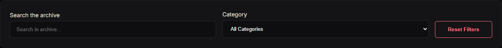

# Anime Legacy Platform

Anime Legacy is an editorial archive about Japanese animation. The catalog connects narrative themes, fictional worlds, and character archetypes with series and multimedia references.



## Run locally

Serve the project root via HTTP. The application uses native JavaScript modules and a bundled dataset.

```sh
python -m http.server 4173 --bind 127.0.0.1
```

Open http://127.0.0.1:4173/. Press the search button for quick matches, or open the archive to combine keyword and category filters. Archive filters are encoded in the URL and can be shared. The search matches names, titles, genres, and themes. Detail pages retain their own address.

## Checks

Run `node --test` with Node.js 24. Tests cover name and theme matching, category filters, exact detail identifiers, and HTML escaping. The browser UI has no runtime package dependencies.

## Italiano

L’archivio esplora storie, mondi narrativi e archetipi dell’animazione giapponese. Avvia il server Python dalla radice e apri l’indirizzo indicato sopra. I filtri dell’archivio si possono condividere tramite URL. Il catalogo locale funziona anche quando le risorse esterne risultano indisponibili.

## Academic context and media

Authors: Michele Magrone and Giovanni Rutigliano. The project was developed for **Progettazione e Produzione Multimediale (PPM)**, Università degli Studi di Bari Aldo Moro, Department of Computer Science (ITPS), A.Y. 2024/2025. The [academic archive](docs/academic_archive) includes the original documentation and manual.

Series and character names, artwork, and embedded trailers belong to their respective rightsholders. The archived project does not establish redistribution permissions for the bundled illustrations. This repository does not declare an open-source license.
